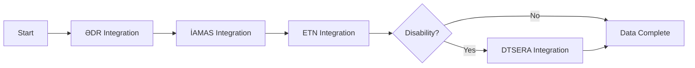
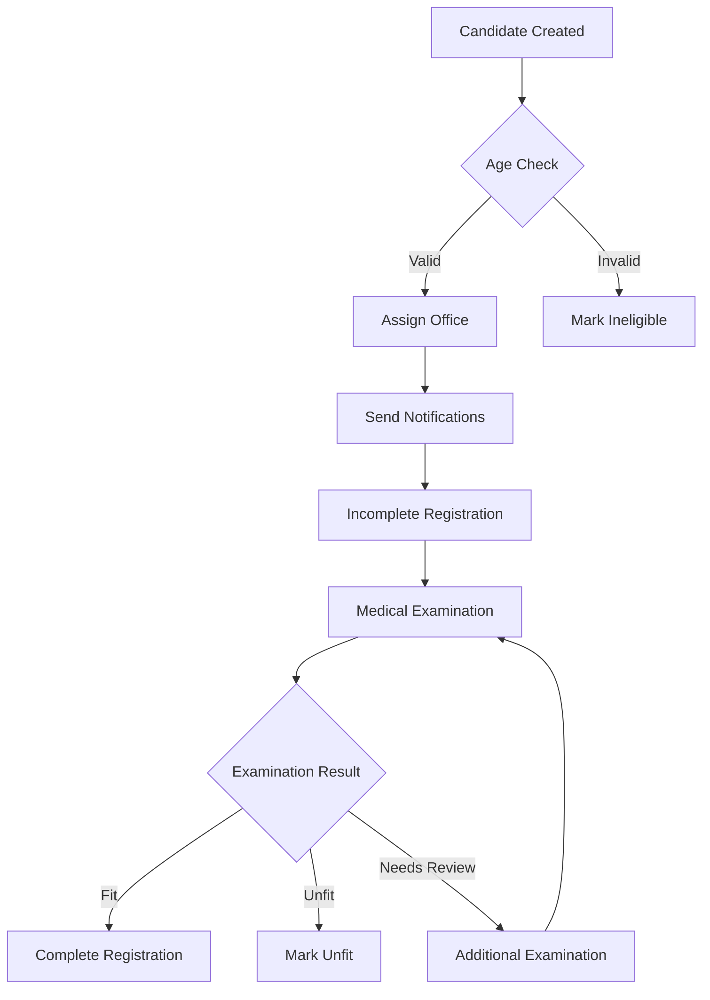

# MMS (Military Management System) Database Schema Documentation

## Table of Contents
1. [Executive Summary](#executive-summary)
2. [System Architecture Overview](#system-architecture-overview)
3. [Database Design Patterns](#database-design-patterns)
4. [Core Modules](#core-modules)
   - [Base Entities](#1-base-entities)
   - [Account Management](#2-account-management-module)
   - [Catalog/Reference Data](#3-catalogreference-data-module)
   - [Management Module](#4-management-module)
   - [System & Infrastructure](#5-system--infrastructure)
   - [Initial Registration Module](#6-initial-registration-module)
5. [Business Process Flows](#business-process-flows)
6. [Integration Architecture](#integration-architecture)
7. [Data Migration Strategy](#data-migration-strategy)
8. [Security & Compliance](#security--compliance)
9. [Appendices](#appendices)

---

## Executive Summary

The Military Management System (MMS) is a comprehensive enterprise application designed to manage military personnel registration, tracking, and administration. This document provides a complete technical reference for the database schema, including all entities, relationships, and business rules.

### Key Features
- **Person-Centric Architecture**: Central management of personnel data
- **Modular Design**: Separated functional modules for scalability
- **Audit Trail**: Complete tracking of all data changes
- **Integration Ready**: Built-in support for external system integrations
- **Security First**: Role-based access control and data protection

### Document Purpose
This documentation serves as:
- Technical reference for developers
- System architecture guide for architects
- Business logic documentation for analysts
- Integration guide for external systems

---

## System Architecture Overview

### Core Design Principles

#### 1. Person-Centric Model
```
┌─────────────────────────────────────────────┐
│                   PERSON                     │
│              (Central Entity)                │
└──────────────────┬──────────────────────────┘
                   │
     ┌─────────────┼─────────────┐
     │             │             │
┌────▼────┐  ┌────▼────┐  ┌────▼────┐
│  USER   │  │DOCUMENT │  │WORKPLACE│
└─────────┘  └─────────┘  └─────────┘
```

#### 2. Modular Architecture
- **Account Management**: User authentication and authorization
- **Catalog Management**: Reference data and lookups
- **Document Management**: Official document handling
- **Support System**: Ticketing and issue tracking
- **File Transfer**: Secure file sharing
- **Initial Registration**: New personnel onboarding

#### 3. Data Integrity
- Foreign key constraints
- Soft delete implementation
- Audit trail on all changes
- Transaction consistency

---

## Database Design Patterns

### 1. Base Entity Pattern
All entities inherit from base classes providing common functionality:

```csharp
BaseEntity
├── Id (GUID)
├── DomainEvents (List)
└── Methods for event handling

AuditableEntity : BaseEntity
├── CreatedBy
├── CreatedOn
├── LastModifiedBy
├── LastModifiedOn
├── IsDeleted
├── DeletedBy
└── DeletedOn
```

### 2. Soft Delete Pattern
Entities are never physically deleted, maintaining data integrity and audit trail:
- `IsDeleted` flag marks deletion
- `DeletedBy` tracks who deleted
- `DeletedOn` records deletion time

### 3. History Tracking Pattern
Critical entities maintain complete change history:
- Separate history tables for each entity
- Captures before/after states
- Includes timestamp and user information

### 4. Normalized Search Pattern
Entities include normalized fields for efficient searching:
- `NormalizedName` for case-insensitive searches
- `NormalizedFullName` for person searches
- Pre-computed for performance

---

## Core Modules

### 1. Base Entities

#### BaseEntity
Abstract base class providing:
- **Id**: Unique identifier (GUID)
- **DomainEvents**: Event sourcing support
- **Event Methods**: AddDomainEvent, RemoveDomainEvent, ClearDomainEvents

#### AuditableEntity
Extends BaseEntity with audit fields:
- **CreatedBy**: User who created the record
- **CreatedOn**: Creation timestamp
- **LastModifiedBy**: User who last modified
- **LastModifiedOn**: Last modification timestamp
- **IsDeleted**: Soft delete flag
- **DeletedBy**: User who deleted
- **DeletedOn**: Deletion timestamp

---

### 2. Account Management Module

#### User Management System

##### **User Entity**
Central authentication and authorization entity.

| Field | Type | Description |
|-------|------|-------------|
| Username | string | Unique username |
| NormalizedUsername | string | Uppercase for searching |
| DomainAccount | string | Active Directory account |
| PasswordHash | string | Encrypted password |
| PasswordChangedOn | DateTime? | Last password change |
| IsEnabled | bool | Account active status |
| LastLoginOn | DateTime? | Last successful login |
| FailedLoginAttempts | int | Failed login counter |
| LockoutEndsOn | DateTime? | Account lockout expiry |
| ForcePasswordChange | bool | Force password reset flag |
| UserTypeId | int | User classification |
| PersonId | Guid | Link to Person entity |

**Relationships:**
- One-to-One: Person
- One-to-Many: PasswordHistories, UserRoles, UserHistories
- Many-to-Many: Roles (through UserRoles)

##### **Person Entity**
Core personal information storage.

| Field | Type | Description |
|-------|------|-------------|
| Name | string | First name |
| Surname | string | Last name |
| FatherName | string | Patronymic name |
| NormalizedFullName | string | Full name for searching |
| BirthDate | DateTime | Date of birth |
| GenderId | int | Gender reference |
| SourceTypeId | int | Data source type |
| PinCode | string | Personal identification number |
| IsActive | bool | Active status |

**Relationships:**
- One-to-One: User
- One-to-Many: PersonDocuments, PersonContacts, PersonWorkplaces

##### **PersonDocument Entity**
Official document management.

| Field | Type | Description |
|-------|------|-------------|
| PersonId | Guid | Owner person |
| DocumentTypeId | int | Document classification |
| Serial | string | Document serial |
| Number | string | Document number |
| IssuedDate | DateTime | Issue date |
| ExpireDate | DateTime? | Expiration date |
| IsActive | bool | Current validity |

**Features:**
- File attachments support
- History tracking
- Termination reasons

##### **PersonWorkplace Entity**
Employment and assignment tracking.

| Field | Type | Description |
|-------|------|-------------|
| PersonId | Guid | Employee |
| MilitaryEnlistmentId | int | Military office |
| PositionId | int | Job position |
| StartDate | DateTime | Assignment start |
| EndDate | DateTime? | Assignment end |
| IsActive | bool | Current assignment |

#### Authorization System

##### **Role-Based Access Control (RBAC)**

```
User ──┬──► UserRole ◄──┬── Role
       │                 │
       └─────────────────┼──► RolePermission ◄── Permission
                         │
                         └── Dynamic Permissions
```

##### **Security Features**
- **Password Policy**: Configurable password requirements
- **Password History**: Prevents password reuse
- **Account Lockout**: Automatic lockout after failed attempts
- **JWT Tokens**: Secure API authentication
- **Refresh Tokens**: Token renewal mechanism

---

### 3. Catalog/Reference Data Module

#### Geographic & Administrative

##### **Country Entity**
| Field | Type | Description |
|-------|------|-------------|
| Name | string | Country name |
| Code | string | ISO country code |
| IsActive | bool | Active status |

##### **Region Entity**
| Field | Type | Description |
|-------|------|-------------|
| Name | string | Region name |
| RegionTypeId | int | Region classification |
| ParentRegionId | int? | Parent region |
| Code | string | Region code |

#### Organizational Structure

##### **Organization Entity**
| Field | Type | Description |
|-------|------|-------------|
| Name | string | Organization name |
| NormalizedName | string | Search-optimized name |
| OrganizationGroupId | int | Organization category |
| DisplayOrder | int | UI display order |
| IsActive | bool | Active status |

##### **MilitaryEnlistment Entity**
Military recruitment offices.

| Field | Type | Description |
|-------|------|-------------|
| Name | string | Office name |
| RegionId | int | Geographic region |
| MilitaryEnlistmentTypeId | int | Office type |
| Code | string | Office code |
| IsActive | bool | Operational status |

#### Military Structure

##### **Military Hierarchy**
```
MilitaryStructureGroup
        │
        ├── MilitaryStructure
        │       │
        │       ├── MilitaryPosition
        │       └── MilitaryRank
        │
        └── TroopType
```

##### **MilitaryRank Entity**
| Field | Type | Description |
|-------|------|-------------|
| Name | string | Rank title |
| Code | string | Rank code |
| Level | int | Hierarchy level |
| Category | string | Officer/Enlisted |

#### Document Management

##### **DocumentType Entity**
| Field | Type | Description |
|-------|------|-------------|
| Name | string | Document name |
| Code | string | Document code |
| RequiresSerial | bool | Serial requirement |
| HasExpiration | bool | Expiration tracking |
| IsActive | bool | Active status |

##### **Document Lifecycle**
```
Created → Active → Expired/Terminated
           ↓
        Renewed
```

---

### 4. Management Module

#### Official Document Registration System

##### **OfficialDocumentRegistration Entity**
Tracks official document lifecycle.

| Field | Type | Description |
|-------|------|-------------|
| DocumentTypeSerialId | int | Document type/serial |
| DocumentStatusId | int | Current status |
| MilitaryEnlistmentId | int | Issuing office |
| Number | string | Document number |
| PersonDocumentId | Guid | Related person document |

**Status Flow:**
```
Draft → Pending → Approved → Issued → Active → Expired
         ↓          ↓
      Rejected   Cancelled
```

#### Support Ticket System

##### **SupportTicket Entity**
Issue tracking and resolution system.

| Field | Type | Description |
|-------|------|-------------|
| TicketCode | string | Unique ticket ID |
| MilitaryEnlistmentId | int | Reporting office |
| SupportTicketTypeId | int | Issue category |
| SupportTicketPriorityId | int | Priority level |
| SupportTicketStatusId | int | Current status |
| Content | string | Issue description |

**Features:**
- File attachments
- Comment threads
- Assignment tracking
- Status transitions
- Priority management

##### **Ticket Workflow**
```
New → Assigned → In Progress → Resolved → Closed
        ↓            ↓             ↓
    Reassigned   On Hold      Reopened
```

#### File Transfer System

##### **FileTransfer Entity**
Secure file sharing mechanism.

| Field | Type | Description |
|-------|------|-------------|
| Name | string | Display name |
| FileName | string | Physical file name |
| FilePath | string | Storage location |
| FileSizeInBytes | long | File size |
| PasswordHash | string | Access password |
| RecipientCount | int | Total recipients |
| DownloadedCount | int | Download counter |
| IsActive | bool | Availability status |

**Security Features:**
- Password protection
- Download limits
- Access tracking
- Automatic expiration

---

### 5. System & Infrastructure

#### ClientRequest Entity
API request tracking and monitoring.

| Field | Type | Description |
|-------|------|-------------|
| RequestId | Guid | Unique request ID |
| Endpoint | string | API endpoint |
| Method | string | HTTP method |
| RequestBody | string | Request payload |
| ResponseCode | int | HTTP response code |
| ResponseTime | long | Processing time (ms) |
| ClientIp | string | Client IP address |
| UserAgent | string | Client user agent |

---

### 6. Initial Registration Module

#### Overview
The Initial Registration Module manages the complete lifecycle of new military personnel registration, from initial data collection through final enrollment.

#### Process Architecture

```
External Systems          Initial Registration          Core System
     │                           │                           │
     ├── ƏDR ──────────►  Candidate ─────►  Enlisted ─────► Person
     ├── İAMAS ─────────►  Management      Processing       Migration
     ├── ETN ───────────►      │               │               │
     └── DTSERA ────────►  Validation ─► Examination ─► Decision
```

#### Core Tables

##### **InitialRegistrationCandidate**
Candidates for initial registration.

| Field | Type | Description |
|-------|------|-------------|
| PinCode | string | Personal ID number |
| FirstName | string | First name |
| LastName | string | Last name |
| MiddleName | string | Middle name |
| BirthDate | DateTime | Date of birth |
| BirthCountry | string | Country of birth |
| PlaceOfBirth | string | Place of birth |
| Gender | string | Gender |
| RegistrationAddress | string | Registration address |
| DataSource | string | Data source system |
| AddedDate | DateTime | Addition date |
| RegistrationStatus | int | Registration status |
| AssignedMilitaryEnlistmentId | int? | Assigned office |
| Status | int | Current status |
| RemovalStatus | int? | Removal status |
| RemovalReason | int? | Removal reason |
| IsActive | bool | Active status |

**Related Tables:**
- InitialRegistrationCandidateHistory
- InitialRegistrationCandidateDocument
- InitialRegistrationCandidateContact
- InitialRegistrationCandidateRelative
- InitialRegistrationCandidateEducation
- InitialRegistrationCandidateDisability

##### **InitialRegistrationEnlisted**
Enlisted personnel in registration process.

| Field | Type | Description |
|-------|------|-------------|
| InitialRegistrationCandidateId | Guid | Source candidate |
| PinCode | string | Personal ID |
| Status | int | Current status |
| DecisionWaitingReason | int? | Waiting reason |
| MyGovStatus | string | MyGov notification |
| LastExaminationStatus | int? | Examination status |
| IsActive | bool | Active status |

##### **InitialRegistrationExamination**
Medical examination tracking.

| Field | Type | Description |
|-------|------|-------------|
| InitialRegistrationEnlistedId | Guid | Enlisted person |
| ExaminationType | int | Examination type |
| ExaminationStatus | int | Current status |
| SentDate | DateTime | Notification date |
| ExaminationDate | DateTime? | Examination date |
| Result | string | Examination result |
| Notes | string | Additional notes |

#### Status Management

##### **Registration Status Flow**
```
1. YSB təyin edilməyib (Office not assigned)
        ↓
2. YSB təyin edilib (Office assigned)
        ↓
3. Qeydiyyat gözlənilir (Registration pending)
        ↓
4. Natamam qeydiyyatdadır (Incomplete registration)
        ↓
5. Qərar verilməyib (No decision)
        ↓
6. Qərar gözlənilir (Decision pending)
        ↓
7. İlkin qeydiyyat tamamlanıb (Registration completed)
```

##### **Examination Status Types**
- Mygov bildirişi göndərilib (MyGov notification sent)
- SMS bildirişi göndərilib (SMS notification sent)
- Tibb müəssisəsinə yaxınlaşıb (Attended medical facility)
- Müayinə yekunlaşıb (Examination completed)
- Müayinə ləğv edilib (Examination cancelled)

#### Integration Tables

##### **IntegrationLog**
External system integration tracking.

| Field | Type | Description |
|-------|------|-------------|
| ServiceName | string | Service identifier |
| RequestData | string | Request payload |
| ResponseData | string | Response payload |
| Status | string | Integration status |
| ErrorMessage | string | Error details |
| RequestDate | DateTime | Request timestamp |
| ResponseDate | DateTime | Response timestamp |
| ProcessingTime | long | Processing duration |

##### **DataSyncStatus**
Data synchronization tracking.

| Field | Type | Description |
|-------|------|-------------|
| PinCode | string | Person identifier |
| ServiceName | string | Service name |
| LastSyncDate | DateTime | Last sync time |
| SyncStatus | string | Sync status |
| ErrorMessage | string | Error details |
| RetryCount | int | Retry attempts |

---

## Business Process Flows

### Initial Registration Process

#### Phase 1: Data Collection


1. **ƏDR Integration**
   - Retrieve: Name, Surname, Father Name
   - Retrieve: PIN Code, Birth Date
   - Retrieve: Gender, Birth Place

2. **İAMAS Integration**
   - Retrieve: Identity documents
   - Retrieve: Contact information
   - Retrieve: Family relationships

3. **ETN Integration**
   - Retrieve: Education level
   - Retrieve: Institution details
   - Retrieve: Academic performance

4. **DTSERA Integration** (Conditional)
   - Retrieve: Disability status
   - Retrieve: Medical codes
   - Retrieve: Examination dates

#### Phase 2: Candidate Management

##### Office Assignment Rules
```
IF location = "Xankəndi" THEN assign to "Xocalı"
ELSE IF location = "Naftalan" THEN assign to "Goranboy"
ELSE IF location = "Pirallahı" THEN assign to "Xəzər"
ELSE use statistical_code for automatic assignment
```

##### Age Criteria Processing
- **14-15 years**: Next year conscription candidates
- **15-17.9 years**: Current conscription age
- **18+ years**: Over age limit (non-recoverable)

#### Phase 3: Registration Processing



#### Phase 4: Data Migration

Upon successful registration completion:

1. **Create Person Record**
   - Transfer personal information
   - Validate data integrity
   - Set active status

2. **Create User Account**
   - Generate credentials
   - Assign initial roles
   - Set password policy

3. **Register Documents**
   - Create PersonDocument records
   - Link to official registrations
   - Set document status

4. **Assign Workplace**
   - Create PersonWorkplace record
   - Set military enlistment
   - Assign position

---

## Integration Architecture

### External System Integrations

#### 1. ƏDR (State Registration Service)
**Purpose**: Primary source for citizen data
**Protocol**: SOAP/REST API
**Data Retrieved**:
- Personal identification
- Birth information
- Current address

#### 2. İAMAS (Identity Management System)
**Purpose**: Identity document verification
**Protocol**: REST API
**Data Retrieved**:
- Document details
- Biometric data
- Photo records

#### 3. ETN (Education System)
**Purpose**: Educational background
**Protocol**: REST API
**Data Retrieved**:
- School enrollment
- Academic records
- Graduation status

#### 4. DTSERA (Disability Assessment)
**Purpose**: Medical disability status
**Protocol**: SOAP API
**Data Retrieved**:
- Disability degree
- Medical codes
- Examination schedule

### Integration Patterns

#### Retry Logic
```
MAX_RETRIES = 3
RETRY_DELAY = [1s, 5s, 30s]

FOR attempt = 1 TO MAX_RETRIES:
    TRY:
        result = CallExternalService()
        LogSuccess()
        RETURN result
    CATCH:
        LogError()
        IF attempt < MAX_RETRIES:
            WAIT RETRY_DELAY[attempt]
        ELSE:
            MarkAsFailed()
```

#### Data Validation
1. **Schema Validation**: Verify data structure
2. **Business Rule Validation**: Check business constraints
3. **Duplicate Detection**: Prevent duplicate records
4. **Data Sanitization**: Clean and normalize data

---

## Data Migration Strategy

### Migration from Initial Registration to Core System

#### Pre-Migration Checklist
- [ ] All required fields populated
- [ ] Data validation passed
- [ ] No pending examinations
- [ ] Decision recorded
- [ ] Documents verified

#### Migration Process

```sql
-- Step 1: Create Person record
INSERT INTO Person (Id, Name, Surname, FatherName, BirthDate, GenderId, PinCode)
SELECT 
    NEWID(),
    FirstName,
    LastName,
    MiddleName,
    BirthDate,
    Gender,
    PinCode
FROM InitialRegistrationEnlisted
WHERE Status = 'Completed'

-- Step 2: Create User account
INSERT INTO User (Id, Username, PersonId, UserTypeId)
SELECT 
    NEWID(),
    PinCode,
    PersonId,
    @StandardUserType
FROM Person
WHERE SourceTypeId = @InitialRegistration

-- Step 3: Migrate documents
INSERT INTO PersonDocument (...)
SELECT ... FROM InitialRegistrationCandidateDocument

-- Step 4: Migrate contacts
INSERT INTO PersonContact (...)
SELECT ... FROM InitialRegistrationCandidateContact
```

#### Post-Migration Validation
1. Verify record counts
2. Validate data integrity
3. Check relationship consistency
4. Audit trail verification
5. Performance testing

---

## Security & Compliance

### Data Protection

#### Personal Data Classification
- **Highly Sensitive**: PIN codes, biometric data
- **Sensitive**: Names, addresses, contact info
- **Internal**: System metadata, logs
- **Public**: Reference data, catalogs

#### Access Control Matrix

| Role | Read Personal | Write Personal | Read System | Admin |
|------|--------------|----------------|-------------|-------|
| Admin | ✓ | ✓ | ✓ | ✓ |
| Officer | ✓ | ✓ | ✓ | ✗ |
| Clerk | ✓ | Limited | ✗ | ✗ |
| Viewer | Limited | ✗ | ✗ | ✗ |

### Audit Requirements

#### Mandatory Audit Events
1. User authentication (login/logout)
2. Data modifications (create/update/delete)
3. Document operations
4. Status changes
5. Integration calls
6. Access denials

#### Audit Log Retention
- **Authentication logs**: 1 year
- **Data change logs**: 5 years
- **Document logs**: 10 years
- **Integration logs**: 90 days

### Compliance Standards

#### GDPR Compliance
- Right to access
- Right to rectification
- Right to erasure (soft delete)
- Data portability
- Privacy by design

#### Local Regulations
- Military service law compliance
- Personal data protection act
- Document retention requirements
- Cross-border data restrictions

---

## Appendices

### Appendix A: Database Indexes

#### Performance-Critical Indexes
```sql
-- Person searches
CREATE INDEX IX_Person_PinCode ON Person(PinCode)
CREATE INDEX IX_Person_NormalizedFullName ON Person(NormalizedFullName)

-- Document lookups
CREATE INDEX IX_PersonDocument_PersonId ON PersonDocument(PersonId)
CREATE INDEX IX_PersonDocument_DocumentTypeId ON PersonDocument(DocumentTypeId)

-- User authentication
CREATE UNIQUE INDEX IX_User_NormalizedUsername ON User(NormalizedUsername)
CREATE INDEX IX_User_PersonId ON User(PersonId)

-- Initial registration
CREATE INDEX IX_InitialRegistrationCandidate_PinCode ON InitialRegistrationCandidate(PinCode)
CREATE INDEX IX_InitialRegistrationCandidate_Status ON InitialRegistrationCandidate(Status)
```

### Appendix B: Common Queries

#### Find Person by PIN
```sql
SELECT p.*, u.Username, pw.MilitaryEnlistmentId
FROM Person p
LEFT JOIN User u ON p.Id = u.PersonId
LEFT JOIN PersonWorkplace pw ON p.Id = pw.PersonId AND pw.IsActive = 1
WHERE p.PinCode = @PinCode
```

#### Active Registration Candidates
```sql
SELECT 
    irc.*,
    me.Name as OfficeName,
    irs.Name as StatusName
FROM InitialRegistrationCandidate irc
JOIN MilitaryEnlistment me ON irc.AssignedMilitaryEnlistmentId = me.Id
JOIN InitialRegistrationStatus irs ON irc.Status = irs.Id
WHERE irc.IsActive = 1
  AND irc.RemovalStatus IS NULL
ORDER BY irc.AddedDate DESC
```

### Appendix C: Error Codes

| Code | Description | Resolution |
|------|-------------|------------|
| E001 | Duplicate PIN code | Check existing records |
| E002 | Invalid age range | Verify birth date |
| E003 | Missing required field | Complete all mandatory fields |
| E004 | Integration timeout | Retry after delay |
| E005 | Document expired | Renew document |
| E006 | Invalid status transition | Check business rules |
| E007 | Unauthorized access | Verify permissions |
| E008 | Data validation failed | Review input data |

### Appendix D: Glossary

| Term | Definition |
|------|------------|
| **ƏDR** | Electronic State Registry (Elektron Dövlət Reyestri) |
| **İAMAS** | Identity and Migration Management System |
| **ETN** | Education Tracking Number system |
| **DTSERA** | Disability and Social Protection Agency |
| **YSB** | Military Enlistment Office (Yerli Səfərbərlik Bölməsi) |
| **PIN** | Personal Identification Number |
| **FİN** | Tax Identification Number |
| **MyGov** | Government services portal |

### Appendix E: Version History

| Version | Date | Changes | Author |
|---------|------|---------|--------|
| 1.0 | 2024-01-01 | Initial documentation | System Team |
| 1.1 | 2024-01-15 | Added Initial Registration Module | Development Team |
| 1.2 | 2024-02-01 | Updated integration architecture | Integration Team |
| 1.3 | 2024-02-15 | Added security compliance section | Security Team |

---

## Contact Information

For questions or clarifications regarding this documentation:

- **Technical Support**: tech-support@mms.gov
- **Documentation Team**: docs@mms.gov
- **Security Issues**: security@mms.gov

---

*This document is classified as INTERNAL USE ONLY and should not be distributed outside the organization without proper authorization.*

*Last Updated: February 2024*
*Document Version: 1.3*
*Classification: Internal*